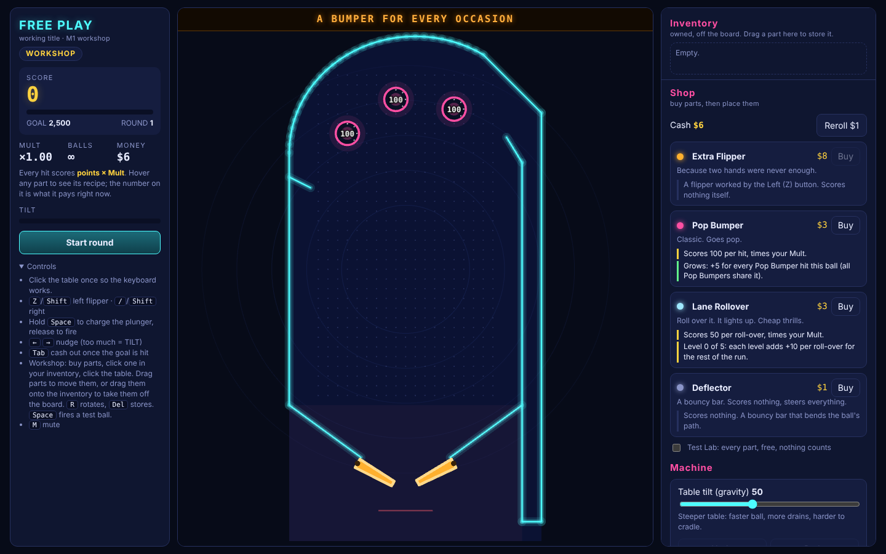
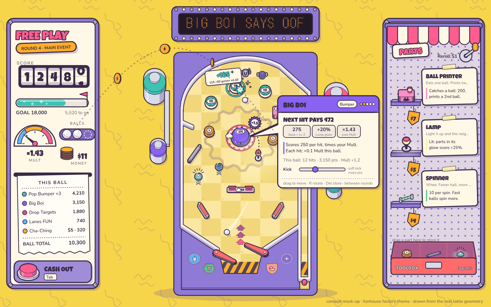
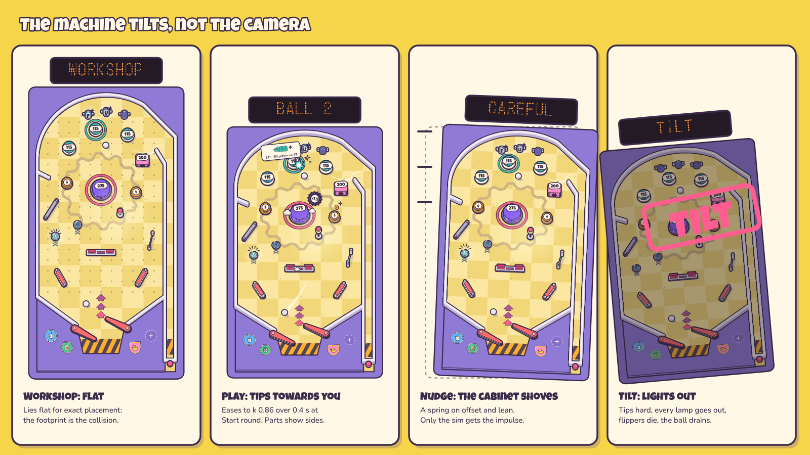
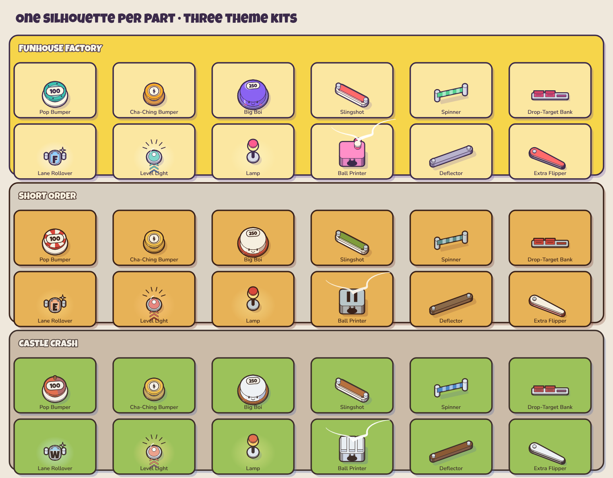
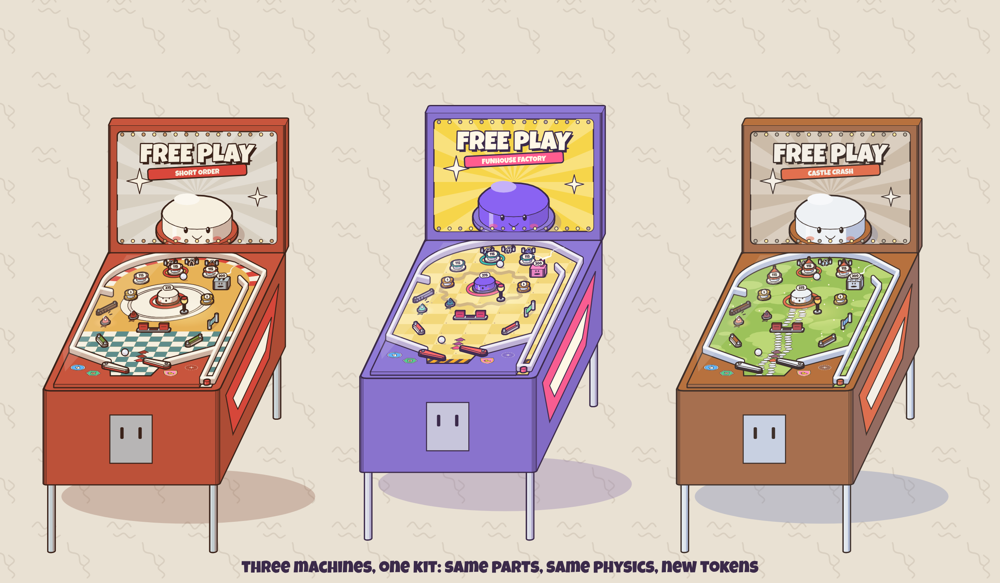
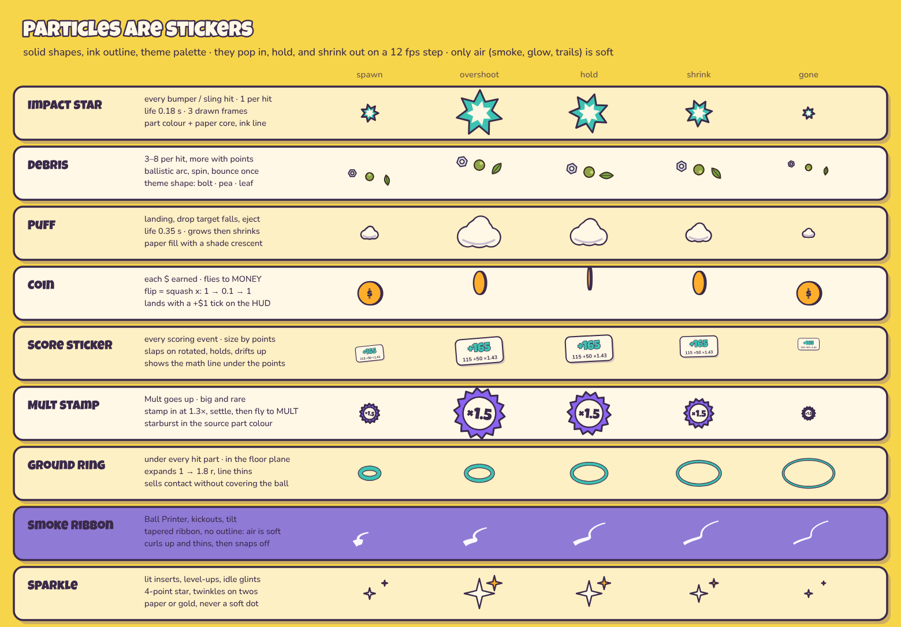
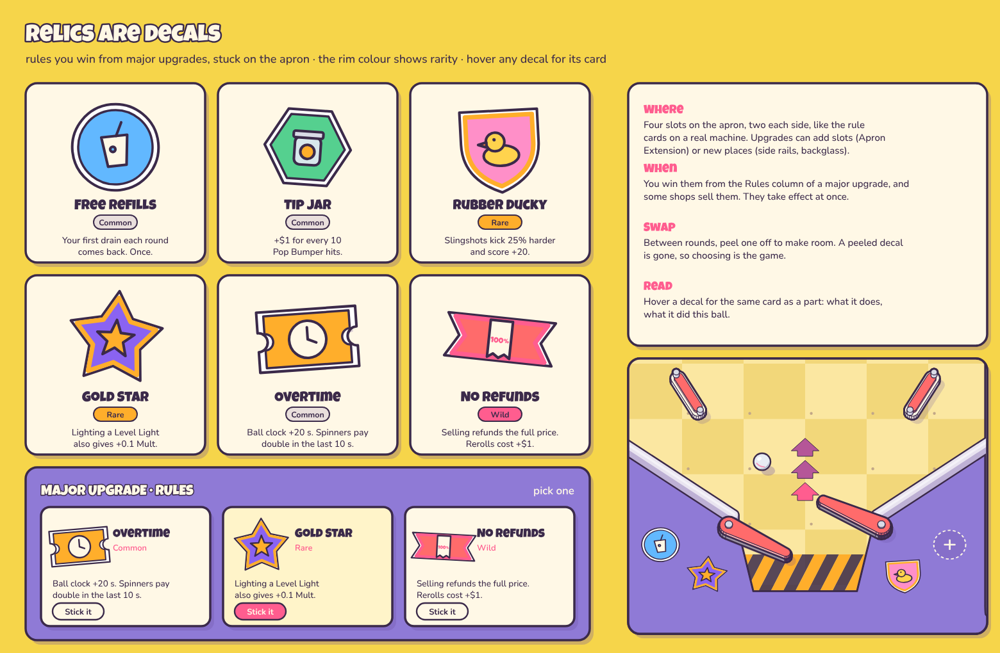
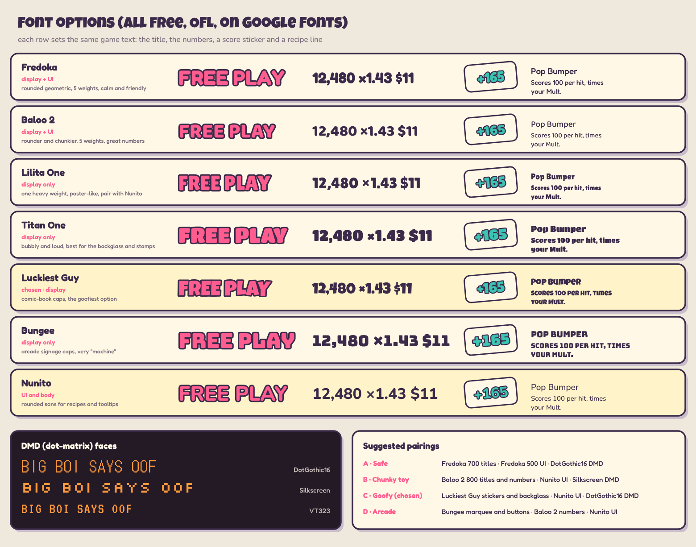
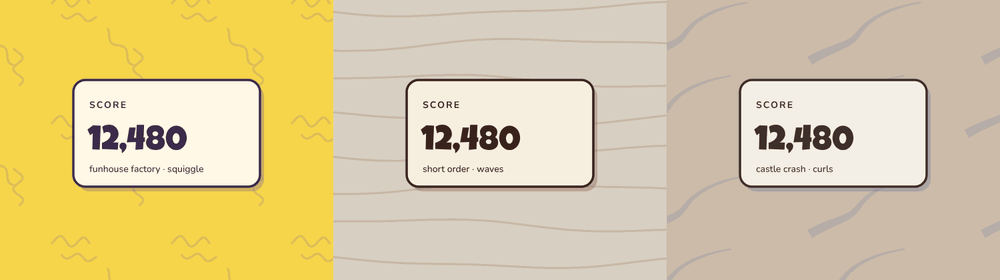

# Art direction: Toybox Diorama (draft v0.2)

What the five style references have in common, how that becomes a look for a pinball game, how one kit can produce many themed machines, and what particles, UI, type and motion should look like. The concept sheets in [concept/](concept/) are **generated from the game's own table geometry and part data** (`npm run concept`, source in `tools/concept/`), so they are a working prototype of the pipeline, not paintings we have to match by hand.

| | |
|---|---|
|  |  |
| Today: neon placeholder | Concept: *Funhouse Factory* theme, same table, same build |

v0.2 changes from feedback: the HUD panels became objects (a scoreboard machine, a parts counter); a hover tooltip; apron stickers became **relic decals**; livelier Lane Rollover and Level Light; the **goofy type pairing** (Luckiest Guy + Nunito + DotGothic16); slowly drifting backdrops instead of dots; **the machine tilts, not the camera**; a plan for bigger and more parts (§10).

## 1. What connects the references

The five images: a juice-box café cut open, a castle on a cliff, a pencil sharpener that is a bookshop, a Game Boy that is a café, and an isometric "life production" factory.

1. **A world inside an object.** Every one of them is a thing (a carton, a sharpener, a Game Boy, a machine) with a small inhabited world inside or on it. The object's silhouette frames the scene, and the scene is the reward for looking closer. **A pinball machine already is this**: a cabinet with a world on its playfield and another one in its backglass. This is the strongest link and the reason the style suits us.
2. **A three-quarter view with no perspective.** Isometric or oblique, viewed from above at an angle, parallel lines stay parallel. You can see tops *and* fronts, so things read as solid toys, yet nothing gets smaller with distance, so the whole scene stays legible at once (our "fixed view of the whole table" rule).
3. **Chunky, coloured outlines.** A thick contour round each object and thinner lines inside it. The line is a dark hue *from the palette* (brown on the juice box, plum on the sharpener, navy on the factory), never pure black. This is what makes everything look like a sticker or a toy, and it keeps busy scenes readable.
4. **Flat cel shading with one light.** Two or three flat tones per material (base, shade, highlight), light from the upper left, hard edges, almost no gradients. The castle adds one painterly trick worth stealing: **warm light, cool shadows** (blue-grey shade under orange roofs).
5. **A small, warm palette on a quiet background.** Five to eight colours, one plain warm-neutral or single-colour background (beige, butter yellow, periwinkle), and a single hot accent (the red-and-white awning, the pink sharpener body).
6. **Rounded, bevelled, toy-like shapes.** Soft corners, slightly chunky proportions, simple primitives (cylinders, boxes, cones). It reads as "handmade miniature" rather than "technical drawing".
7. **Density of tiny, funny detail.** Little characters doing things, signs, plants, labels, steam. Detail is concentrated in clusters with calm areas between them, so the eye has places to rest.
8. **Machines with whimsy (the factory).** Conveyor belts, pipes, gauges and tanks connected into one absurd production line. This is our premise almost word for word: *a machine that shouldn't exist*.

## 2. The direction in rules

Call it **Toybox Diorama**: the machine is a handmade toy world on a cabinet, drawn as stickers.

1. **Every object is a sticker.** Thick outer contour (2× the inner line) in the theme's ink colour, thin inner lines, flat fills. Implemented as a two-pass draw (`Prop` in `tools/concept/draw.ts`): the silhouette in ink with a fat stroke, then the coloured faces on top.
2. **Three tones per material, derived, not picked.** A theme picks base colours only; shade = base pushed 34% towards the theme's *shadow hue*, mid = 16%, light = 50% towards white (`mat()` in `themes.ts`). The shadow hue can be cool against a warm palette (castle). This is what lets one person make many themes.
3. **Light from the upper left, always.** Right-facing faces take the shade tone, left-facing faces the light tone, and drop shadows fall down and to the right in the shadow hue at about 20% opacity.
4. **Glow lives only in lamps and inserts.** Lit things (lane inserts, Level Light domes, the Lamp's pool, backglass bulbs) are the one place for soft radial light. Everything else is flat. That way "lit" always means something in the rules.
5. **Shape carries identity, colour comes second.** Each part keeps one silhouette in every theme; the theme only changes colours and one motif. A Pop Bumper is always a round cap on a skirt; it can wear an awning, a turret roof or rivets. This is also our colour-blind-safety plan.
6. **A few parts are characters.** Big Boi and the Ball Printer have faces; most parts are furniture. The faces react (Big Boi goes "oof" when hit). Goofy, but rationed so the table doesn't become noise.
7. **Detail goes round the edges, calm stays in the middle.** Busy art sits on the rim, the apron, the backglass and the surroundings (tanks, condiment bottles, pine trees). The ball's lanes stay quiet so the ball is always the most readable thing on screen.
8. **The UI is part of the diorama** (§6): panels are machines and shop fittings built from the same sticker kit, not flat web cards.

## 3. Bringing it to the playfield

**Projection.** The sim stays top-down and 2D. The renderer uses an oblique projection over the sim's own coordinates: `screen = (x + y·shx, −(y·k + z·kz))`. `k` is how far the machine is tipped towards you (1 = flat, seen from straight above), `kz` how tall heights are drawn, `shx` a sideways lean (key art only). The rules:

- **The footprint on the floor is the collision shape.** Height only grows upwards, so a part's base outline is exactly where the ball bounces. Drop shadows and ground rings sit on the footprint, which helps the eye find it.
- **Keep heights low.** Parts stand 0.5 to 2 ball diameters tall. A ball passing behind a tall part is drawn on top of it anyway (or as an x-ray outline) so it is never hidden.
- **Draw far things first** (sort by sim y); walls are continuous stacked strokes.

**Layers of a machine (each one themed):** cabinet rim and side art · playfield floor art · inserts (the only glowing things) · walls and rails · parts · balls and trails · particles · live-value tags and score stickers · apron decals (§7) · backbox (marquee with the DMD) · surroundings (the diorama base) · the drifting backdrop (§9).

**Readability budget:** the ball is the brightest, highest-contrast object (near-white with an ink outline everywhere); parts are mid-value; the floor is the lowest contrast; effects may cover the floor but not the ball.

### The machine tilts, not the camera



The camera never moves (a plan decision). The *machine* does:

| State | k (tip) | What happens |
|---|---|---|
| **Workshop** | 1.0 (flat) | Lies flat with a placement grid: what you see is exactly the collision footprint, for precise building. |
| **Play** | 0.86 | On *Start round* the machine eases forward over ~0.4 s, so parts show their sides and the table feels physical. It eases back when the round ends. |
| **Nudge** | 0.86 | The whole cabinet shoves sideways and leans 1–3° on a damped spring, with shove lines; the sim gets the impulse as today. Nothing in the sim moves with the art. |
| **Tilt warning / TILT** | 0.8 | Warnings make the cabinet rattle and the DMD flash; on TILT it tips hard, every lamp and insert goes out, flippers die and the ball drains. |

This settles the aiming worry: you build flat, and the tip only happens while the ball is live, where a few percent of squash does not matter. Pointer picking inverts the projection on the floor plane, so it works in either state. Calm mode keeps the tip but drops the shove and rattle.

## 4. One kit, many machines



A theme is a data row (`tools/concept/themes.ts`), the same idea as the parts catalogue:

| Token | What it does | Factory / Diner / Castle |
|---|---|---|
| `bg`, `paper`, `ink`, `shadeTint` | page, cards, outline colour, the hue shadows lean to | butter + plum / beige + brown / sand + cool blue |
| `floor`, `floor2`, `floorArt` | playfield paint and its pattern | riveted plates and a painted gear / checker tiles, a giant plate, awning stripes / meadow and a cobbled path |
| `rail`, `rim`, `metal`, `rubber` | walls, cabinet wood, posts, rubber | |
| `role.*` | one colour per part type, all distinguishable in that theme | |
| `popMotif` | the Pop Bumper's hat (and the Ball Printer's roof) | rivets / awning / turret cone |
| `laneWord` | what the Lane Rollovers spell, one letter each | FUN / EAT / WIN |
| `debris` | the theme's confetti | bolts and gears / peas and sprinkles / leaves and stone chips |
| `surround` | the diorama the table stands in | tanks and pipes / condiment bottles / pine trees |
| `backdrop` | the drifting page behind the machine (§9) | squiggles / waves / smoke curls |
| backglass | title, tagline banner, the mascot (Big Boi in the theme's skin) | |

**The two dull parts, redone.** The **Lane Rollover** is now a real lane: two guide posts, a wire switch and a lit letter insert, and the lanes in a set **spell the theme's word** (F-U-N), the way real machines do, so "light them all" reads at a glance. The **Level Light** is now a glass dome over a bulb, tinted by the part type it levels up, with rank chevrons on the floor and rays when lit, so it says "this upgrades Pop Bumpers" without a tooltip.



**Cost of a new machine** once the kit is in the game: about 25 colour tokens, one motif, one floor pattern, one lane word, one debris shape, a surround set, a backdrop style and a backglass. No new part drawings. A theme can also carry rules (the Diner could be the "Tax Man" boss table), but that is a design question for later.

**Checks per theme (automate them):** every `role` colour must differ from its neighbours and from `floor` by a minimum contrast; ink against paper must pass WCAG AA for text; the ball must be the highest-contrast object against `floor`.

## 5. Particles



The references have almost no "effects" in the usual sense (glows, sparks, additive blur), so ours follow the same rules as the props: **particles are stickers.**

1. **Solid shapes, ink outline, theme palette.** No additive blending, no soft dots. Shapes come from the theme (bolts, peas, leaves) so effects say which machine you are in.
2. **They pop in, hold, and shrink out.** Scale `0.45 → 1.18 → 1.0 → 0.68 → 0` over the particle's life (overshoot then settle). They do not fade: fading flat shapes looks like a bug. Only *air* (smoke, glow, motion trails) is soft and outline-free, like the castle's ribbon smoke.
3. **Animate shape on a 12 fps step, move at full frame rate.** Positions update every frame so motion is smooth; the shape (frame of the impact star, the coin's flip, a sparkle's twinkle) advances on a 1/12 s step, which reads as hand-drawn ("on twos").
4. **Every effect points at its cause and its consequence.** The impact star sits on the contact point, the ground ring under the part that was hit, and a coin *flies to the money stack* and lands with a +$1 tick; a Mult stamp flies to the Mult dial and kicks its needle. This is the "juice that reveals the causal chain" pillar from the plan.
5. **Size by value, count by rarity.** Small hits make small, few particles; a set bonus or a Mult change gets the big stamp. Cap live particles at about 150 and stickers at 16 (as today).

| Effect | Trigger | Life | Notes |
|---|---|---|---|
| Impact star | every bumper / sling hit | 0.18 s, 3 frames | part colour with a paper core |
| Debris | every scoring hit, 3–8 pieces | 0.5–0.8 s | ballistic, spins, bounces once on the floor |
| Puff | landing, a drop target falling, an eject | 0.35 s | paper with a shade crescent |
| Coin | each $ earned | ~0.6 s flight | flip = squash x; flies to the money stack |
| Score sticker | every scoring event | ~0.9 s | the existing popup, now a paper sticker with the math line |
| Mult stamp | Mult rises | ~1 s | starburst in the source part's colour, flies to the Mult dial |
| Ground ring | under every hit part | 0.25 s | in the floor plane, never covers the ball |
| Smoke ribbon | Ball Printer, kickouts, tilt | 0.6–1 s | tapered ribbon, no outline |
| Sparkle | lit inserts, level-ups, idle glints | twinkles | 4-point star, paper or gold |
| Ball trail | fast balls | per frame | tapered paper ribbon at 75% |

**Ambient motion (cheap, reads as "alive"):** factory conveyor arrows crawl, diner steam curls off the toaster, castle flags flutter, backglass bulbs chase. Each is a looping 2–4 frame swap.

**Accessibility:** Calm mode drops the 12 fps twinkles, the screen shake, the bulb chase and the backdrop drift, and halves the particle counts; the stickers that carry information (score, coin, Mult) stay.

## 6. The UI panels are machines

The left and right panels were flat cards: clear, but boring. They are now objects that belong in the diorama, built from the same kit (the arcade button, the balls and the parts on the shelves are drawn by the same prop code as the table). Every piece still shows exactly the same information as before.

**Left: the scoreboard** (a housing with screws, paper inside)
- **Score on odometer drums.** Fixed-width digit drums, the last one mid-roll while points tick. Fixed widths also stop the number wobbling as it changes.
- **Goal as a glass tube** filling with the theme's Pop colour, bubbles rising, a flag at the goal, and "5,520 to go" under it (the number you actually need).
- **Mult as a pressure dial.** Cool, warm and hot zones; the needle swings when a Mult stamp lands.
- **Balls in a tray** (real ball sprites, used ones as dashed ghosts) and **money as a coin stack** that grows when coins fly in.
- **The ledger as a receipt** printed out of a slot, with dotted leaders and a ball total. A new line prints when a new part scores.
- **Cash Out is a big arcade button** with its key on a label (Tab).

**Right: the parts counter** (an awning over a pegboard)
- Offers stand on **shelves** as the real 3D parts, with a **hanging price tag** and a taped recipe card.
- **Reroll is a crank** (the sharpener reference), with its price on it.
- **The inventory is a toolbox** with the stored parts in compartments; drag a part into it to store it.

**Rules that keep it clear:** information never hides behind decoration (labels in the UI face, values in the display face, one idea per widget); every widget animates only when its value changes; one hot accent per panel (the Cash Out button, the awning).

### Tooltips: what it is, what it pays now, why, how to change it

The hover card (Big Boi in the screen above) has a fixed anatomy, generated from the part's recipe data like today's recipe text:

1. **Header** in the part's colour: name, kind chip, level pips.
2. **The headline number:** "Next hit pays 472".
3. **The math as chips:** `275` base + level · `+20%` Lamp glow · `×1.43` your Mult. Any cross-part effect (a Lamp, a decal) appears as its own chip, and a dotted line on the table connects the hovered part to the part that boosts it.
4. **The recipe sentence** (unchanged from today).
5. **This ball:** hits, points, Mult added.
6. **Its dial** with the trade-off in words ("soft kick, more pts").
7. **Controls** in small print (drag, R, Del, "between rounds").

The card has a tail to the part, the part gets a dashed selection ring, and the card never covers the part itself. The same card is used for shop items, toolbox items and decals.

## 7. Relics are decals



The stickers on the apron became **relic decals**: run-long rules (the "Rules" column of the major upgrades in [run-flow-and-balance.md](run-flow-and-balance.md)) that you stick onto the machine.

- **Where:** four slots on the apron, two each side, where real machines put their rule and price cards. An empty slot shows a dashed "+". Upgrades can add slots (Apron Extension) or new places (side rails, the backglass).
- **When:** won from the Rules column of a major upgrade (pick one of three), and sometimes sold in the shop. They take effect at once.
- **Swap:** between rounds you can peel one off to make room; a peeled decal is gone, so choosing is the game.
- **Look:** die-cut vinyl: a white cut margin, the ink line, a colour field, one icon. The **shape is unique per decal** so you can tell them apart at a glance; the **rim colour shows rarity** (paper = Common, gold = Rare, hot accent = Wild).
- **Read:** hovering a decal opens the same tooltip as a part: what it does, and what it did this ball.

The six on the sheet are placeholders to show the range, not balanced designs: *Free Refills* (first drain comes back), *Tip Jar* (+$1 per 10 Pop hits), *Rubber Ducky* (Slingshots kick harder and score more), *Gold Star* (Level Lights also give Mult), *Overtime* (longer ball clock, spinners pay double late), *No Refunds* (full sell refunds, dearer rerolls; it would also settle open question 4 of the plan for players who want it).

## 8. Typography: the goofy pairing



All candidates are free (SIL Open Font License) on Google Fonts. **Chosen: C, Goofy**:

| Role | Face | Where |
|---|---|---|
| Display | **[Luckiest Guy](https://fonts.google.com/specimen/Luckiest+Guy)** | titles, big numbers (score drums, ×Mult, $), score stickers, stamps, part names on cards, the backglass, lane letters |
| UI | **[Nunito](https://fonts.google.com/specimen/Nunito)** (500–800) | recipes, tooltips, ledger lines, labels, buttons' small print |
| DMD | **[DotGothic16](https://fonts.google.com/specimen/DotGothic16)** | the dot-matrix display, behind the dot mask |

**One rule decides which face:** bold text at 19 px or larger uses the display face, everything else the UI face (that is literally how the concept code chooses). Luckiest Guy is all caps and has one weight, so it is never bolded (fake bold smears it) and never used for sentences. It sits a little high on its baseline; nudge it down about 6% of its size. The others stay on the sheet for comparison: Fredoka (what the first concepts used), Baloo 2, Lilita One, Titan One, Bungee, and Silkscreen or VT323 for the DMD.

## 9. The backdrop drifts



The plain dot grid became **hand-drawn line marks that drift slowly**, one style per theme: **squiggles** (Factory), **wavy contour lines** (Diner), **soft smoke curls** like the castle reference (Castle).

- **Barely there:** one tone darker than the background (17% towards the shadow hue), never outlined, never above the HUD's contrast.
- **Slow:** one tile of drift and one wiggle period per loop. The GIF loops in 6 s (about 40 px/s at full size); in the game try a 10–12 s loop (15–25 px/s). It must never compete with the ball.
- **Seamless:** every mark lives in a repeating tile and drifts exactly one tile per loop, so it is one cheap tiling sprite in the game, scrolled with a phase.
- **It can react, slightly:** speed up a little during multiball or a hot Mult, freeze on TILT, and stop entirely in Calm mode.

## 10. Plan: bigger parts and more parts (when we are ready)

We will add many more parts and much bigger ones (ramps, an upper playfield, the legendary toys: the Hand, the Castle, the Head). Nothing changes now; this is how the art side should be built when that starts, so every new part arrives already themed.

**1. Describe props as data, not code.** Each part gets a *prop spec* next to its row in `src/data/parts.ts`, built from the primitive library the concepts already use (cylinder, prism, cone, dome, ribbon, plate, wire, post):

```ts
prop: {
  size: 'S',                            // S ≤ 1.2 · M ≤ 3 · L ≤ 6 · XL = a zone or a level
  layers: [                             // drawn bottom to top; z in ball diameters
    { prim: 'cyl', r: 1.0, z: [0, 0.16], mat: 'paper' },
    { prim: 'cyl', r: 0.62, z: [0.16, 0.66], mat: 'metal' },
    { prim: 'cyl', r: 0.88, z: [0.66, 0.9], mat: 'role', slot: 'hat' },   // the theme motif goes here
  ],
  label: { z: 0.9 },                    // where the live value sits
  fx: { impact: 'rim', emit: [] },      // where effects spawn (a chimney, a mouth, a rim)
  face: null,                           // optional character face slot
  states: { lit: {...}, hit: {...}, down: {...} },
}
```

The base layer is generated from the part's collision `shape`, so the art's footprint and the physics can never disagree. A part needing something special gets a small draw hook, not a new system.

**2. Size classes have rules.**

| Class | Examples | Rules |
|---|---|---|
| S | bumpers, rollovers, lamps | one silhouette, a motif slot, no theme-specific art |
| M | banks, the printer, kickers, magnets | may have one character face; still the same in every theme |
| L | toys, ramps, spinning discs | **theme-specific hero art allowed** (the Castle toy *is* a castle in Castle Crash and a giant press in the Factory), but the mechanical role and footprint stay the same; budget about three hero toys per theme |
| XL | upper playfield, a second level | its own floor art and rails, drawn as a raised layer |

**3. Height and hiding.** Big parts hide the ball. Rules: S and M stay under 2 ball diameters; L parts use **cutaway on demand** (the references' cut-open boxes): the part's front faces fade to a glass outline when a ball is behind it, and the ball always gets an x-ray outline. Ramps and upper levels are translucent tinted plastic (like the sharpener's yellow glass box).

**4. Layers and ramps.** The sim gives balls a layer (floor, ramp, upper). The renderer draws per layer: floor layer, its parts and balls, then the ramp plastic, then ramp balls, then the upper layer. Ramp entrances and exits get floor inserts so the shot reads.

**5. Rendering at scale.** Bake each part × state × theme into a texture once (rotatable parts in 5° buckets, made lazily, or drawn live if they are cheap); keep big toys as a few layers so a moving bit (the Hand's fingers) animates without redrawing the rest. Budget: ~40 part types × 3 states × N themes stays small as textures at the game's resolution.

**6. Tooling that keeps it consistent.**
- A **prop lab** page (dev only) that renders every part in every theme and state, like the parts sheet, with a footprint overlay.
- A **visual snapshot test** in the browser smoke run so a theme or prop change shows up in review.
- The **theme checks** from §4, extended to new role colours as the catalogue grows (shape stays the first identifier once colours run out).

**7. Order of work** when the time comes: prop spec and primitive library in `src/render` → port the 12 existing parts to specs (they double as the test set) → size-class rules and the cutaway → layers and the first ramp → the first L toy in one theme, then its versions in the other two.

## 11. How to build the look in the game (PixiJS v8)

1. **Theme kit module** (`src/render/theme.ts`): move the tokens and `mat()` from `tools/concept/themes.ts` into `src`. Replace the colours hard-coded in `renderer.ts` with role colours from the theme.
2. **Prop drawing → textures.** Port the prop drawers (`props.ts`) from SVG strings to Pixi `Graphics` calls (nearly one to one: `poly`, `circle`, `fill`, `stroke`), then to the data specs of §10. Draw each part type × state × theme **once** into a texture (`renderer.generateTexture`) and show sprites; redraw only when a theme or a part's state changes. Today the renderer clears and redraws every shape every frame.
3. **Projection in one place, with the machine tilt.** Add `P(x, y, z)` with `k` animated between workshop (1.0) and play (0.86), and the nudge spring as a transform on the machine container; pointer picking inverts it on the floor plane.
4. **Floor art, the surround and the backdrop** as static or tiling layers, rendered once per layout; the backdrop is a `TilingSprite` scrolled by phase.
5. **Particles:** bake each particle shape per theme into a small atlas, run them in a `ParticleContainer`, and apply the scale curve and the 12 fps frame step in the update. Stickers stay `Container`s with text.
6. **HUD:** rebuild the panels as Pixi containers (or keep them as HTML styled to match; the HTML route is faster and keeps text crisp, the Pixi route lets coins fly into the money stack without crossing layers). My default: HTML panels plus a transparent Pixi overlay for the flying effects.
7. **Fonts:** bundle Luckiest Guy, Nunito and DotGothic16 (all OFL) locally.
8. **Content:** the hero theme first (Factory), then Diner and Castle as the proof that a theme is only data.

Suggested order: theme tokens and colours (a day), projection, tilt and rails (a day or two), prop textures for the 12 parts (several days), particles (a few days), HUD reskin with tooltips and decal slots (a few days), backdrop (hours). It fits M3 ("art direction") in the roadmap, but the token step is cheap enough to do earlier.

## 12. Open questions

| # | Question | My default |
|---|---|---|
| 1 | Which theme is the default machine? | Funhouse Factory: it *is* the premise (a machine that shouldn't exist) |
| 2 | Should themes change rules, or only looks? | Looks only at first; tie themes to bosses or stages later |
| 3 | How many decal slots, and can you buy more? | 4 to start; +1 from an Apron Extension upgrade; peeling is free but destroys the decal |
| 4 | HUD in HTML or in Pixi? | HTML panels with a Pixi overlay for effects that fly between table and panel |
| 5 | A dark theme for night play? | Yes, later: "Night Shift" with the same tokens, which would also suit the Night Shift boss |
| 6 | Hand-painted art from an artist later? | The kit sets the rules an artist would follow; hero art (backglass, key art, L toys) is where a human illustrator adds the most |

## Sources

- Cutaway and breakaway illustration: [Wikipedia, Cutaway drawing](https://en.wikipedia.org/wiki/Cutaway_drawing)
- Isometric construction from simple primitives, clean regular curves: [IBM Design Language, isometric style](https://www.ibm.com/design/language/illustration/isometric-style/design)
- Oblique and axonometric projection in 2D games: [Wikipedia, 2.5D](https://en.wikipedia.org/wiki/2.5D), [Wikipedia, Oblique projection](https://en.wikipedia.org/wiki/Oblique_projection), [A Layman's Guide to Projection in Videogames](https://www.significant-bits.com/a-laymans-guide-to-projection-in-videogames/)
- Coloured outlines instead of black, selective outlining: [Lospec, pixel art outlines part 2: using colour](https://lospec.com/articles/pixel-art-outlines-part-2-using-color), [Graphixly, creating coloured line art](https://graphixly.com/blogs/news/creating-colored-line-art)
- Hand-drawn effects without glow or CG particles: [PlatinumGames blog on Bayonetta Origins' VFX](https://www.platinumgames.com/official-blog/article/12867)
- Pinball artwork anatomy (playfield, inserts, apron, backglass, cabinet art): [Wikipedia, Glossary of pinball terms](https://en.wikipedia.org/wiki/Glossary_of_pinball_terms), [PinWiki glossary](https://pinwiki.com/wiki/index.php/Glossary)
- Fonts: [Luckiest Guy](https://fonts.google.com/specimen/Luckiest+Guy), [Nunito](https://fonts.google.com/specimen/Nunito), [DotGothic16](https://fonts.google.com/specimen/DotGothic16) (all SIL Open Font License, Google Fonts)
