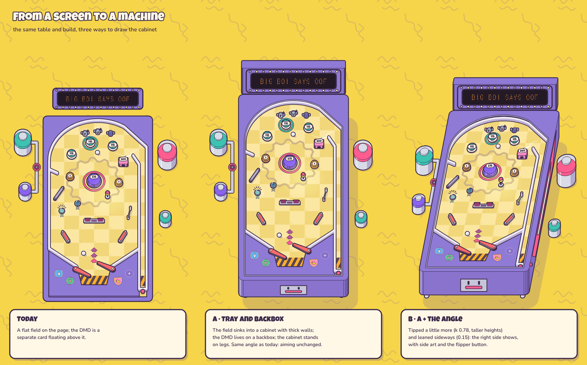
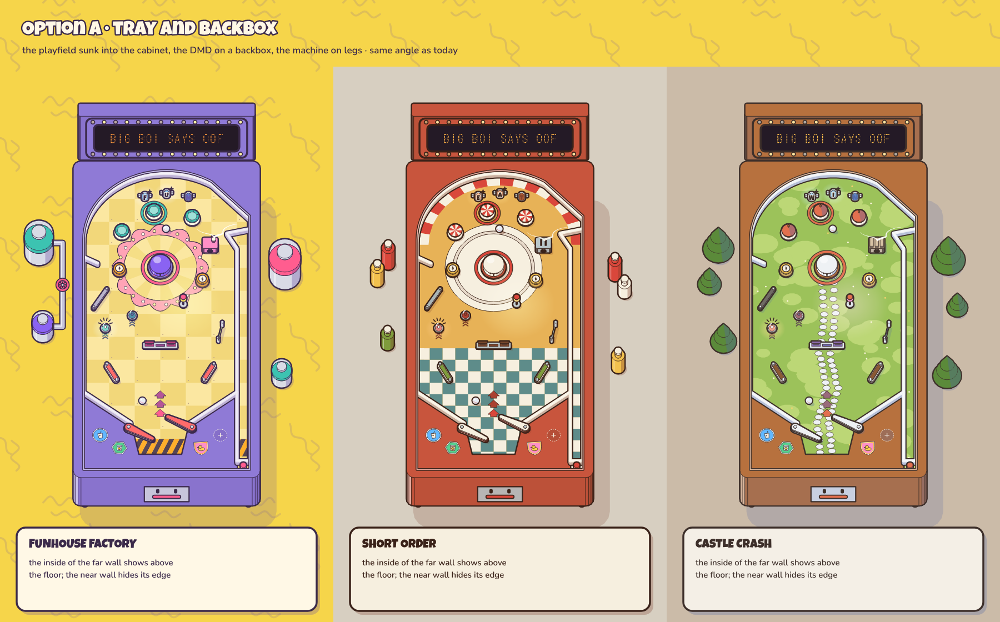
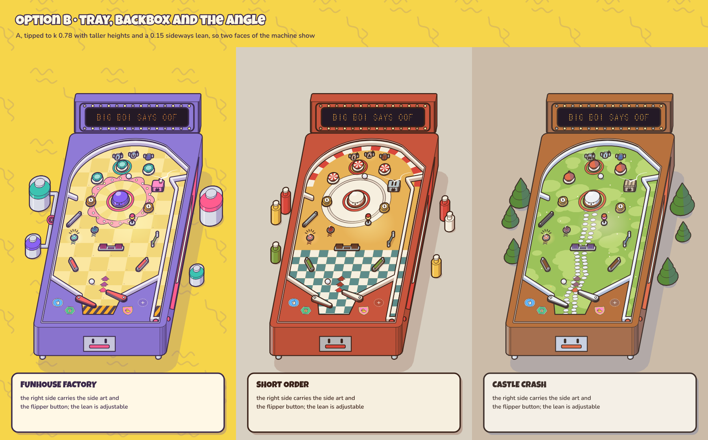

# Art implementation plan (Toybox Diorama)

Status: **implemented (phases A–H).** This was the build plan for the look in [art-direction.md](art-direction.md) (v0.3). The concept sheets in [concept/](concept/) were the target, and `tools/concept/` the reference code it was ported from. What landed, and where it differs from the plan, is in [What was built](#what-was-built) at the end.

## Ground rules

- **The sim never changes for art.** Everything here is presentation: it reads the sim and the event stream and never writes back (as `src/render/renderer.ts` does today). The machine tilt and the nudge shove are visual only.
- **Themes are data and a player choice.** No default machine; the player picks a theme, and a theme changes looks only.
- **One source per fact.** Part recipes keep driving the scorer, the descriptions, the tooltips and the labels on the board. Theme tokens drive every colour. Nothing in `src/render` hard-codes a colour.
- **Port, don't redesign.** Each step below has a concept file to port from; matching the concept sheets is the acceptance test.

## Phases

Each phase ends with the game still playable and the tests green.

### A. Theme kit in `src` (about a day)
- Move `tools/concept/themes.ts` into `src/render/theme.ts`: the three theme rows, `mat()`, `mix()`, `legible()`, `roleClashes()`.
- Replace the hard-coded colours in `renderer.ts`, `style.css` and `src/ui/html.ts` with theme tokens (CSS custom properties for the HTML side).
- A **theme picker** in the options (and later in the run setup), saved in `localStorage`.
- **Done when:** switching theme recolours the table and the panels live; a vitest test runs `roleClashes()` on every theme and fails on a clash.

### B. Projection, machine tilt, rails (1–2 days)
- One projection function `P(x, y, z)` in the renderer (`tools/concept/draw.ts` has it) and its inverse on the floor plane for pointer picking, so placing and dragging keep working.
- Animate `k` from 1.0 in the workshop to 0.86 in play over ~0.4 s, and back.
- **Nudge** as a damped spring on the machine container's offset and lean; **tilt warning** rattle; **TILT** tips to `k` 0.8, turns all lamps and inserts off and dims the field.
- Walls as continuous stacked-stroke rails (`rails()` in `scenes.ts`).
- **Done when:** the four states of the tilt sheet can be seen in the game, and placing a part lands exactly where the pointer is in both the flat and the tipped state.

### C. Props as cached textures (several days)
- Port the prop drawers (`props.ts`, the `Prop` class in `draw.ts`) from SVG strings to Pixi `Graphics` (the calls map nearly one to one).
- Bake each part × state (idle, lit, hit, down) × theme once with `renderer.generateTexture` and show sprites; rotatable parts are baked in 5° buckets on first use, or drawn live if cheap. Today the renderer clears and redraws everything every frame.
- Live-value tags, level pips, the Lane Rollover letters (the theme's `laneWord`) and the Level Light dome tinted by its target.
- Use Pixi's real bounds (`getLocalBounds`) for the fit-and-centre rule of `fitIcon()`.
- **Done when:** every part matches the parts sheet in all three themes, and a full table with multiball holds 60 fps on a mid laptop.

### D. Floor art, surroundings, backdrop, apron (1–2 days)
- Floor patterns (plates and gear, checker and plate, meadow and path), inserts, the apron with its decal slots, and the surround props (tanks with the piped valve, condiment bottles, pine trees), rendered once per layout into a texture.
- The drifting backdrop as a `TilingSprite` scrolled by phase (squiggles, waves, curls), 10–12 s loop, frozen in Calm mode and on TILT.
- **Done when:** the three screen mock-ups match with the HUD hidden.

### E. Particles (a few days)
- Bake the particle shapes per theme into one atlas (impact star frames, debris, puff, coin flip frames, sparkle, stamp) and run them in a `ParticleContainer`.
- The scale curve `0.45 → 1.18 → 1.0 → 0.68 → 0`, shape frames on a 1/12 s step, positions every frame; no fading except air (smoke, trails, glow).
- **Causal targets:** coins fly to the money stack, Mult stamps to the Mult dial. The panel positions come from the DOM (see F), mapped into canvas space.
- Budgets: ~150 live particles, 16 stickers; Calm mode halves counts and drops shake, twinkles and bulb chases.
- **Done when:** the particle sheet's timings are visible in play and the budget holds in a busy multiball.

### F. HUD reskin and tooltips (a few days)
- Keep the panels in **HTML/CSS** (crisp text, easy layout) with a transparent Pixi overlay above them for effects that fly between the table and the panels.
- Build from `tools/concept/ui.ts`: housings with marquee headers, the round strip, odometer drums, the goal tube with its badge, the Mult dial, the ball tray, the receipt ledger, the Cash Out button, the money row, offer cards with Buy buttons, and the toolbox. The small 3D bits (buttons, parts on plinths, toolbox items) are the baked prop textures from C, shown as images.
- **Tooltips** with the fixed anatomy (header, the next-hit number, math chips including cross-part effects, recipe, this ball, the dial, controls), generated from recipe data; the dotted link to a boosting part is drawn on the table.
- **Fonts:** bundle Luckiest Guy, Nunito and DotGothic16 locally (all SIL OFL); apply the "bold and 19 px or more uses the display face" rule in CSS classes.
- Polish rules from art-direction §7 as CSS: the 30 px grid, three line weights, fixed-width numbers, only stuck-on things tilted.
- **Done when:** the screen mock-ups match with live data, and every scoring number on screen can be explained by its tooltip.

### G. Relic decals (needs the major-upgrade flow from M1.5)
- Decal data rows (name, shape, rarity, rule), four apron slots, the Rules column of a major upgrade (pick one of three), peel to remove between rounds, decal tooltips.
- The six on the relic sheet are placeholders; real decals come with the rebalance.
- **Done when:** a run can earn, stick, read and peel decals, and the rules apply in the scorer.

### H. Tooling and tests (alongside the phases)
- `roleClashes()` as a unit test (A).
- A **prop lab** dev page: every part in every theme and state with a footprint overlay (the parts sheet, live).
- **Visual snapshots** in the browser smoke test (`tools/smoke.cjs`) for the workshop and a frozen play frame per theme.
- Keep `npm run concept` working as the design reference until the game matches it; retire it afterwards or keep it for key art.

### Later: bigger and more parts
When ramps, upper playfields and big toys arrive, follow art-direction §11: prop specs as data built from primitives, size classes (S, M, L, XL) with theme-specific hero art only for L, cutaway on demand when a ball is behind a tall part, and render layers per playfield level.

## Order and fit with the roadmap

A → B → C → D → E → F, with H alongside and G after the major-upgrade flow exists. A is cheap and can land any time (even before M1.5); B to F are the "art direction" part of **M3**; G belongs to the M1.5/M2 major-upgrade work.

## Risks

| Risk | Mitigation |
|---|---|
| Baked textures use too much memory with many themes and states | Bake lazily per theme in use; drop other themes' textures on switch |
| The tipped view makes aiming feel off | Build in the flat view; tip only while the ball is live; tune `k` in playtests (0.86 is a starting value) |
| Effects flying between canvas and HTML panels drift out of place | One mapping function from DOM rects to canvas space, recomputed on resize; a smoke-test check |
| Text in Luckiest Guy gets used for sentences | The CSS class rule (display only for bold text of 19 px and up) and a review checklist |
| A new theme's colours clash | `roleClashes()` in the tests blocks it |

## What was built

| Phase | Where | Notes |
|---|---|---|
| A. Theme kit | `src/render/theme.ts` | The three rows, `mat()`, `mix()`, `legible()`, `roleClashes()`, plus `themeProblems()` (ink on paper passes WCAG AA, the ball's outline stands out on the floor, no part melts into the floor) and `themeVars()` (every token as a CSS custom property). `tools/concept/themes.ts` now re-exports it. The extended check (Kickback and Vari-Target are scoring parts too) caught six clashes, fixed: Vari-Target in all three themes, Kickback in all three, and the Factory Lamp against its floor. Part colours left `src/data/parts.ts`: the theme is the one source. The theme picker is the first screen of a fresh game and lives under Machine afterwards (saved in `localStorage`). |
| B. Projection, tilt, rails | `src/render/draw.ts` (`P`, `unP`), `src/render/renderer.ts` | k eases 1.0 → 0.86 over 0.4 s on Start round and back when it ends; TILT tips to 0.8, leans, dims the field and turns lamps and inserts off. k is quantised to 0.02 so baked textures are shared between frames of the tip. Nudge is a damped spring on the machine container (offset and lean), a nudge near the tilt limit rattles the cabinet and flashes the DMD. Picking inverts the machine transform and the projection on the floor plane. |
| C. Props as textures | `src/render/props.ts` | Every part ported to Pixi `Graphics`, baked per part × state × angle (5° buckets) × k into a texture with its base point as the anchor. New drawings for the three parts the concepts did not have: the Kickback (an arrow insert with a piston, lit while armed), the Ball Saver (a looping-arrow insert, lit while a save is ready, with a draining ring), the Vari-Target (four blocks stepping up like a power meter, lit up to the tier of the last hit). The Ball Printer got a floor arrow for its aim. Spinners bake 8 frames of the plate's turn. |
| D. Floor, surround, backdrop | `src/render/scene.ts`, `src/ui/hud.ts` | Floor art, rim, apron, decal slots, rails and the surround render once per tip into one texture (the flat and the play tip are kept). **Deviation:** the backdrop is one seamless SVG tile on a CSS layer moved on the compositor, not a Pixi `TilingSprite`, because it has to run behind the HTML panels too. It drifts one tile per 11 s and freezes in Calm mode and on TILT. |
| E. Particles | `src/render/particles.ts`, `src/render/overlay.ts` | One atlas per theme (impact star frames in every part's colour, debris, puff, sparkles) in a `ParticleContainer`; the scale curve and the 1/12 s shape step as specified; smoke and trails are soft ribbons. Coins fly from the bumper to the money stack and the balance ticks when they land; a rising Mult stamps by the part and flies to the dial, kicking its needle. Budgets: 150 particles, 16 stickers; Calm halves counts and drops shake, twinkles, the bulb chase and the drift. |
| F. HUD and tooltips | `index.html`, `src/style.css`, `src/ui/html.ts`, `src/ui/hud.ts` | HTML panels (scoreboard and parts counter housings with marquee headers) and a transparent Pixi overlay above them for the flying effects. Odometer drums, goal tube, Mult dial, ball tray, receipt ledger, Cash Out arcade button, money row, offer cards with parts on plinths and Buy buttons, the toolbox. Part images are the baked props. The tooltip has the fixed anatomy (header with level pips, next-hit number, math chips including Lamp glow, recipe, this round, the dial and its trade-off in words, controls) and a dotted link on the table to every Lamp that boosts the part. The scoreboard numbers have their own explanations on hover. Fonts are bundled in `src/assets/fonts` (note: Luckiest Guy is Apache 2.0, the other two SIL OFL). |
| G. Relic decals | `src/data/decals.ts`, `Game.decals / canTake / peel` | The Rules column of the major upgrades is now decals: each has a unique shape and a rarity rim, four apron slots, a Rules card waits when the apron is full, and clicking a decal between rounds peels it (gone for good, undoable). Hover reads its rule. The six decals on the relic sheet stay placeholders; the three Rules upgrades in the game (Head Start, Lucky Seven, Ball Hog) are the real ones. |
| H. Tooling | `tests/theme.test.ts`, `tests/decals.test.ts`, `lab.html`, `tools/smoke.cjs` | Colour checks and the particle curve as unit tests; decal rules as unit tests; the prop lab at `/lab.html` (every part, theme and state with its footprint, and a tip slider); the smoke test picks a theme on first visit, maps sim to screen through `__pinball.toScreen`, checks decals and the tip, probes the frame cost, and saves workshop and play snapshots per theme. `npm run concept` still works. |

### After the first playtest

- **One size:** the machine no longer tips between building (1.0) and playing (0.86); it keeps one tip (0.9) in every mode, and the centre column keeps a fixed layout, so nothing grows or shrinks between rounds. TILT still leans the cabinet, dims the field and turns the lights out.
- **The scoreboard follows the loop:** its title reads BUILD or PLAY, and its one big button is PLAY ROUND (Enter) while you build and CASH OUT (Tab) while you play. The stepper over the table reads Play → Shop → Place.
- **Score drums:** four to start (0000), one more whenever the score needs it.
- **Shop:** compact offers (the part, its name, its flavour line, the price) that always fit without scrolling; the full recipe is in the tooltip. The shop folds away during play, leaving the money and the toolbox. The upgrade picker floats over the top of the table.
- **Toolbox:** four slots. Buying stops when it is full, and a part stored in a full toolbox (or granted by an upgrade) is sold for its sell price.
- **Less text:** no "times your Mult" on every part, no dial sentences in the recipe, the Kick dial is now called Bounce, and the spare-ball note left the money row.
- **Controls:** ← → work the flippers (all flippers on that side), Space shoots, Z X nudge; the keys for the current mode sit in one line under the table.

### The cabinet as a diorama object (option A, built)

To read as a pinball machine rather than a screen, like the cut-open objects in the style references: sink the playfield into a cabinet with thick walls (the inside of the far wall shows, the near wall hides the floor's edge, a light cut edge round the opening), raise a backbox from the head of the table that carries the DMD, and stand the machine on legs. Option B also tips it to k 0.78 with taller heights and leans it 0.15 sideways so the right side (side art, flipper button) shows.

| | |
|---|---|
|  | today, A and B side by side (Factory) |
|  | A in all three themes |
|  | B in all three themes |

Rendered by `npm run concept` (`dioramaMachine()` in `tools/concept/scenes.ts`).

Option A is in the game: the playfield sunk into the cabinet (walls 1.6 high, the inside of the far wall showing, a light cut edge), the backbox carrying the display, the coin door on the front and little legs under it. The display is now a real dot matrix drawn on the backbox: text is rasterised from bold Nunito into lit dots (the thin DotGothic16 face was hard to read and is gone), new messages scroll in from the right and settle in the middle, long ones keep scrolling, and a tilt warning flashes it. Other changes from the same playtest: a fixed Big Boi in the middle of every machine whose pupils follow the nearest ball, the scoreboard titled PLAY or WORKSHOP with no step pills, a fifteen-stop map of the run instead of the round strip, and buying by dragging an offer onto the table or the toolbox.

### Juice pass

- **Sound:** every part type has its own synthesised voice (a rubbery boing for Pop Bumpers, a ka-ching for Cha-Ching, a low thump for Big Boi, a snap for Slingshots, rattling ticks for Spinners, a thunk for drop targets and so on), still climbing the Mult ladder; shop cards tick as they roll in, buying rings, placing clunks, the receipt chatters as it prints. A soft arcade loop plays underneath, one tune per theme (bouncy square-wave Factory, swung jazzy Diner, plucked dorian Castle), with its own switch.
- **The display** idles on the live score while you play (and the round and goal in the workshop), flashes every hit at once, and comments scroll in, hold about two seconds and clear.
- **Hits** shake the part that was hit; only strong hits shake the table (presentation only, never the sim).
- **Score pop-ups** are frameless chunky numbers that fly out of the hit in an arc in their own direction; from 1,000 they turn gold with a burst behind, from 5,000 they sparkle.
- **Big Boi's moods:** happy, oof when hit, sad after a drain, a limp plunge or a tilt, shocked at a completed set, a printed ball or a new Mult band, and sunglasses from ×3 Mult.
- **The receipt** feeds out of its slot when a round starts and prints each new line as a part type first scores. The round buttons moved to the bottom of the shop panel to give it room.
- **The shop** rolls new stock down onto the shelf. The money row lost its frame and holds the Reroll button (each reroll in a round costs $1 more).
- **The lose screen** greys out the whole page under a summary: the run's map, rounds cleared, total points, parts on the table.
